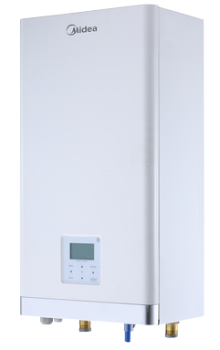
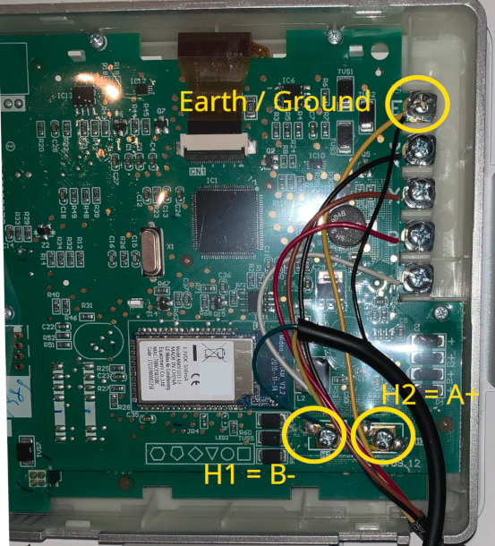
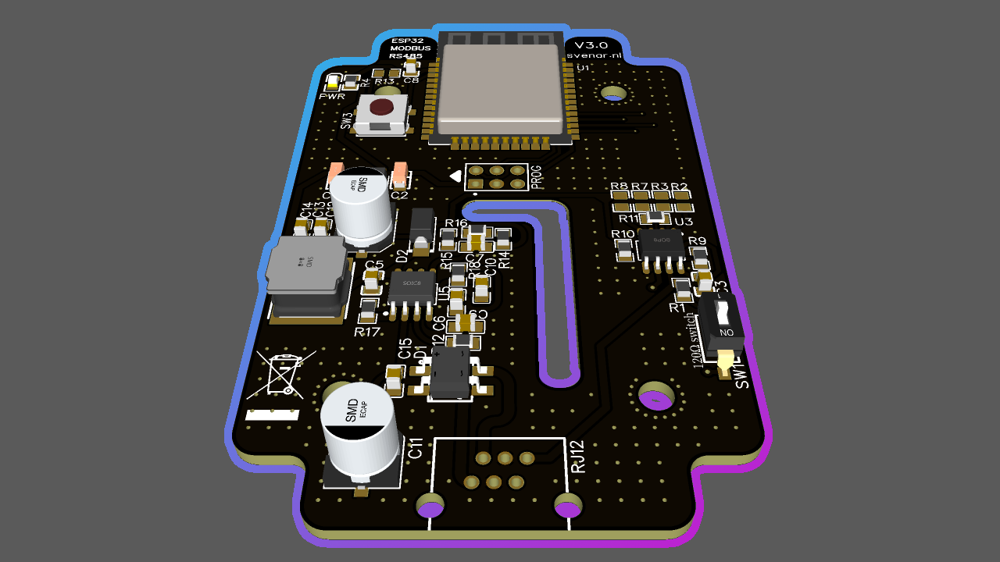
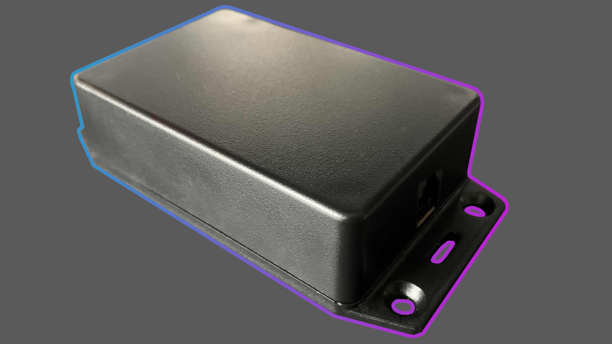

# Midea heat pump (and clones) ESPHome

The Midea heat pump and clones like [Airwell](https://www.airwell.com/en/), [Artel](https://www.artelgroup.com/products-heat-pumps/), [Ferroli](https://www.ferroli.com/int/products/hydronic-heat-pumps-cooling-heating-dhw), [Kaisai](https://www.kaisaisystems.nl), [Inventor](https://www.inventorairconditioner.com/heat-pumps-split-monoblock/split-type-heat-pumps/matrix-split-type), [Kaysun](https://www.kaysun.es/en/products-kaysun/aquantia/), [YORK](https://www.pompycieplayork.pl/produkty/) can be managed using the Modbus protocol. This project contains configuration file(s) which can be placed on an ESPHome enabled device to communicatie using modbus with the heat pump.

**See below for a ready-made ESPHome compatible heatpump controller!!**

## Disclaimer

The information provided for the heat pump is intended for informational purposes only. Its use is entirely at your own risk. We do not take any responsibility for any damage or loss caused by the use of information taken from this project. We strongly recommend that you consult with a professional HVAC technician before making any changes to your heat pump configuration or installation. By using the information from this project, you acknowledge that you understand and accept these terms and conditions.

## Connect a ESPHome board to the heat pump

Connecting a device to the heat pump is not that difficult, but keep the disclaimer in mind. Before you start, disconnect the power from the indoor and the outdoor unit. Never ever open up the heat pump with the power switched on!!

A modbus device has two wires, A+ and B- and optional a ground/earth connection. The modbus device needs to be connected to the "wired controller", this is the display on the model shown.

Detach the front panel of the indoor unit (slide it up) and on the backside you will find a panel that holds the display (wired controller). Open that panel, be warned that the screws used are not alway of the best quality, so use a good fitting screw driver and be gentle.

When the panel of the display is removed, the back of the display is visible, which is a printed circuit board (PCB). On that board, search for the 'earth' connection (letter E) and connections H1 and H2. Attach the earth wire of your modbus device to the earth connection, the B- wire to H1 and A+ wire to H2.

When all is connected, place the back panel of the display back and put back the front panel of the indoor unit.

## Configuration

In the `models` directory you will find multiple yaml files for specific models and more generic ones. Place the content of the model file which is the best fit for your heat pump in your ESPHome device and change the `uart` and `modbus_controller` settings to your needs. The `substitutions` section can be used to change the entities name as they apear in Home Assistant. In the [homeassistant](homeassistant) directory I placed and example dashboard and some example automations.

*If you are not able to find a good fit in the models directory for your heat pump, then try the `R32-generic.yaml`, that will probably work.*

## Switching heating and DHW on and off

These notes were verified on a 14 kW R32 unit (Modbus RTU, slave 1, 9600 8N1). Other models may differ.

**On/off from automations: use register `0x0`**

The switches `Room Temperature Control`, `Water Flow Temperature Control Zone 1`, `Power DHW T5S` and `Water Flow Temperature Control Zone 2` are bits 0 to 3 of register `0x0`: bit 0 is the room thermostat, bit 1 is heating zone 1, bit 2 is DHW (T5S) and bit 3 is heating zone 2. Switching off this way behaves like the user switching it off on the panel and the function stays visible there.

**Do not use the `Parameter Setting 1 Enable ...` switches for this**

`Parameter Setting 1 Enable Heating` and `Parameter Setting 1 Enable Water Heating` (register `210`, bits 7 and 15) are installer options. Clearing them disables the function completely and it disappears from the panel.

**Setpoints**

Register `0x2` holds the zone 1 setpoint in the low byte and zone 2 in the high byte, `0x3` the air temperature (0.5 °C steps) and `0x4` the DHW setpoint. Writing them is reflected on the panel within seconds.

**Heating versus DHW**

`Operating Mode` (register `0x65`) reports 3 for heating, 5 for DHW and 2 for cooling. Load output SV1 (`Load Output SV 1`) was on during the whole DHW cycle. On the tested unit the `Operating Mode` text stayed "Heating" during DHW, so SV1 was the reliable indicator there, which is also what `Active State` uses.

## ESPHome Midea Heatpump Controller

Together with my son [Sven](https://svenar.nl) who is an electronics student, we created an ESPHome compatible heatpump controller for the Midea heatpump (and clones). This controller can be purchased from https://shop.svenar.nl

